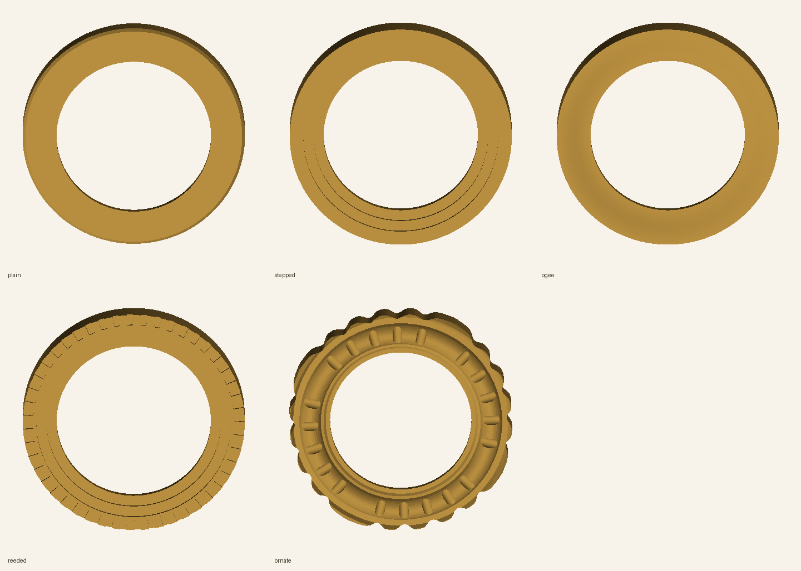
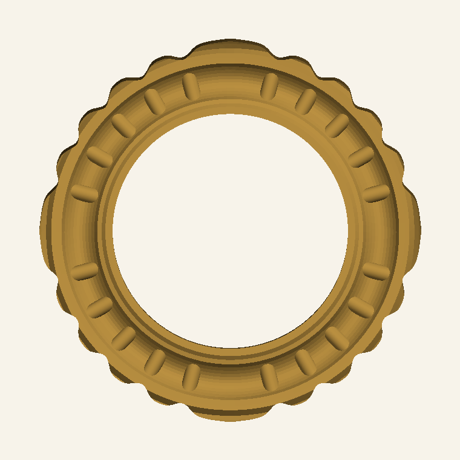

# Display bezels

Six rings that frame the round GC9A01 screens against the dial, from
`build_bezels.py`. `docs/hardware-plan.html` budgets these as the "printed
bezel / diffuser ring", to be brass-finished with spray or a gilt pen so they
match the cabinet's existing hardware.

## Print this

| File | What |
|---|---|
| **`bezel-plate-ornate-x6.stl`** | all six, 226 × 111 mm, 44 g of solid PLA — fits a Prusa MK4 |
| `bezel-plate-ornate-x6.3mf` | same, if you are slicing it yourself |
| `bezel-ornate.stl` / `.step` | one bezel, 5.9 cm³, for a test fit |

**Print one first.** See the warning below.

## The styles

`build_bezels.py --style NAME` makes any of five. All share the same pocket,
lip and mounting; they differ only in the moulding on the front.

| Style | Outer | Thick | What it is |
|---|---|---|---|
| `plain` | 47.5 | 4.9 | a flat land, nothing else |
| `stepped` | 47.5 | 6.3 | two concentric steps |
| `ogee` | 47.5 | 6.3 | the classic cyma recta S-curve |
| `reeded` | 47.5 | 6.3 | radial grooves milled into the outer land |
| **`ornate`** | **53.5** | **7.5** | a carved gilt-frame moulding — the default |

### What `ornate` is and is not

It is after a Louis XV giltwood frame: a dominant convex round, a cove behind
it, an outer bead, a scalloped outline of 24 lobes, flutes across the round,
and a plain cabochon at each quarter standing proud of the lobes.

It does **not** attempt the acanthus scrollwork such frames carry between the
cabochons. On a 1.28 in screen that ornament would be a few tenths of a
millimetre — well under what a 0.4 mm nozzle resolves — and it would print as
mush. Every feature here is at least 1 mm, so it survives printing, priming
and a coat of gilt.

The ornament is **carved, not added**. An earlier version fused domes onto the
round; the solid was correct but each sphere left a cracked edge where its
seam met the fuse boundary, and the exported mesh was unprintable. Cuts
tessellate cleanly, and carving is how the real thing is made anyway.

A `beaded` style existed briefly and was removed for the same reason: its
beads could not be fused into a watertight mesh, and once carved it was
indistinguishable from `reeded`.

## The design

| | |
|---|---|
| Outer diameter | 53.50 mm (`ornate`; 47.50 for the rest) |
| Aperture | 33.00 mm (the lit area is 32.40, so no pixels are covered) |
| Module pocket | 39.90 mm across × 3.30 deep, open at the back |
| Seating lip | 3.45 mm wide |
| Total thickness | 7.50 mm (4.90 web + 2.60 moulding) |
| Mounting | 4 × 1.7 mm blind holes, 3 mm deep, on a 46.5 mm circle |
| Header slot | 16 mm wide through the rim |

The module drops into the pocket from behind and seats against the lip, so the
front face hides the PCB edge and leaves the round glass showing.

**The screws go in from the back.** The holes are blind, so nothing shows on
the finished front — which matters when the ring is brass-finished. The module
ends up sandwiched between the bezel and whatever the bezel screws to. 1.7 mm
takes an M2 self-tapper straight into the plastic.

The 16 mm slot in the rim is for the pin header, which on these carriers is
soldered to the edge of the board. Without it the module cannot sit flat.

### Check the panel before you commit to `ornate`

`build_cad.py` puts the screens on side panels 56 mm wide (`PANEL_W`) at a
70 mm pitch. A 53.5 mm ring leaves **1.25 mm of panel either side** and 16.5 mm
between neighbours. That is enough, but it is not much: if the panels end up
narrower than drawn, build with `--style ornate --rim 5` for a 49.5 mm ring, or
use one of the 47.5 mm styles.

## Measure your module before printing six

The dimensions above come from `build_cad.py`, which records them as
"as ordered" — from a product listing, not from a part in hand. GC9A01
carriers differ between makers, and `docs/circuit-diagram.html` already warns
that even the header order varies.

So: print `bezel-ornate.stl`, drop a real module in, and check three things.

1. **Does it drop into the pocket?** Too tight: raise `--fit`. Too loose:
   lower it.
2. **Does the header clear the slot?** If not, raise `--no-notch` is wrong —
   widen it in the `Bezel` dataclass.
3. **Does the aperture cover any pixels?** Raise `--aperture-margin`.

Only then print the plate of six.

## Untested on hardware

No bezel has been printed and no module has been test-fitted. Everything above
is geometry checked in software: `build_bezels.py` reloads each exported mesh
and refuses any that is not a single watertight body sitting flat on the bed.
