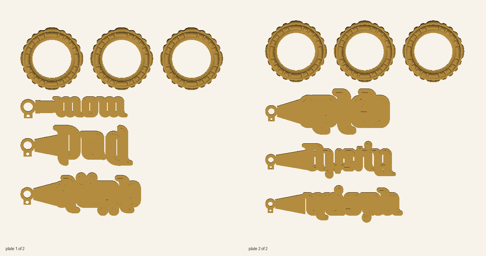

# Ambigram clock hands — print these

Six identical hands, each carrying one person's name, generated from `cad/ambigrams/`
by `build_hands.py`. **Built for option D** (off-axis motors driving the tubes
with belts) and sized to the measured dial.

## Print this one file

Pick by the printer's bed, because the single plate is 226 mm deep and a lot of
common beds are not.

### Prusa MK4 (bed 250 × 210) — two plates, hands *and* bezels



| File | Size | Contains |
|---|---|---|
| `print-plate-mk4-1of2-spear.stl` | 172 × 126 mm, 30 cm³ | Becky, Evan, Elijah + 3 bezels |
| `print-plate-mk4-2of2-spear.stl` | 172 × 126 mm, 30 cm³ | Caleb, Austin, Micah + 3 bezels |

Also as `.3mf` and `.step`, and in `-halo` or `-plaque` for the older shapes. **The two
plates together are the whole front of the clock**: all six hands and all six
display bezels, 12 parts, nothing else to print and nothing to order twice.

Everything sits flat on the bed and nothing overhangs, so no supports.
61 cm³ of PLA if it were printed solid; a normal infill is well under that.

Rebuild them with:

```
python build_hands.py --preset option-d --style spear --plate \
    --bed 250 210 --tag mk4 \
    --extra cad/bezels/bezel-ornate.step --extra-count 6
```

### Bambu A1 / P1S / X1, Prusa XL (bed 256 or bigger) — one plate

| File | Size | Contains |
|---|---|---|
| `print-plate-option-d-halo.3mf` | 119 × 226 mm, 43 g | all six hands |

Also `.stl`, and `-plaque.stl`. **Hands only** — this plate predates the
bezels. Print `cad/bezels/bezel-plate-ornate-x6.stl` alongside it, or just use
the MK4 pair above, which fits any of these beds too.

**A 226 mm plate does not fit an MK4.** Six will technically squeeze on at
249 × 123 mm with `--gap 4`, but that leaves half a millimetre at the edges and
no room for a skirt, so use the two-plate pair instead.

### STL or 3MF?

**Use the 3MF if you are slicing it yourself.** It records the unit as
millimetres, so nothing can scale it by 25.4 by mistake, and it keeps the
parts as separate objects you can colour or move individually. It is also
about half the file size.

**Use the STL if a print service or an unfamiliar tool asks for a file.** STL
is read by everything, and some services accept nothing else. The cost is that
an STL is one undifferentiated soup of triangles with no units — the slicer
has to infer millimetres, and the parts arrive as one object that you may have
to split.

The geometry is identical either way. These 3MFs carry geometry and units
only, not print settings, so there is nothing to miss by choosing the STL.

Every part in every file has been checked after export: watertight, consistent
winding, flat on the bed, no part overlapping another.

## Settings

* **Flat on the bed, name upwards. No supports.**
* 0.2 mm layers, 3 perimeters, 30 % infill. At 2.5 mm it comes out near solid.
* **Two colours with one extruder:** the relief starts at exactly 2.5 mm. Tell
  the slicer to pause there and change filament. Everything above is the name.
* Or print in one colour and drag a lightly loaded brush flat across the
  relief, which catches only the letters.

## The six

| File | Person | Reads | Level | Tip radius | Bore | Screw | Mass |
|---|---|---|---|---|---|---|---|
| `1-becky-*` | Becky | **Mom** | 1 | 85 mm | 7.94 mm | M3 | 4.2 g |
| `2-evan-*` | Evan | **Dad** | 2 | 91 mm | 7.14 mm | M3 | 6.9 g |
| `3-elijah-*` | Elijah | Elijah | 3 | 97 mm | 6.35 mm | M3 | 8.2 g |
| `4-caleb-*` | Caleb | Caleb | 4 | 103 mm | 5.56 mm | M2 | 9.7 g |
| `5-austin-*` | Austin | Austin | 5 | 109 mm | 4.76 mm | M2 | 6.8 g |
| `6-micah-*` | Micah | Micah | 6 | 115 mm | 3.97 mm | M2 | 7.2 g |

## Two things decided for you, both reversible

**The bores are the option D tube stack.** With no motor bores for the tubes to
thread through, six consecutive K&S sizes nest cleanly on a 0.36 mm wall:
5/16, 9/32, 1/4, 7/32, 3/16, 5/32 in. Level 6 goes from 1.59 mm of brass to
3.97 mm, which is a real gain in stiffness. The outermost at 7.94 mm still
passes the dial's centre hole once that is opened to 12.7 mm.

Bores are cut at the **nominal tube OD with no clearance added**. A printed
hole comes out slightly undersize anyway, so expect a light ream to fit — and
reaming a hole out is easy where shrinking one is not. **Test-fit one hand
before printing the rest.**

**The tip radii fill the measured dial.** Caleb's dial is a 9.75 in disc,
123.8 mm radius. The old 70–100 mm radii were sized against `build_cad.py`'s
placeholder 110 mm dial and left 24 mm of bare dial; these run 85–115 mm with
9 mm of chapter ring to spare.

Both live in `OPTION_D` in `build_hands.py`. Change and re-run:

```bash
python build_hands.py --preset option-d --plate              # 256 mm bed
python build_hands.py --preset option-d --plate --bed 220 220  # two plates
python build_hands.py --preset as-drawn                      # the old sizes
```

## If you change anything

The build refuses to export a hand that comes out in pieces, has a bridge under
0.8 mm, or misses its tip radius, and the plate writer loads its own STL back
and refuses a mesh that is not watertight. That last check exists because it
caught a real defect: two letter pieces touching at exactly one point extrude
into an edge shared by four faces, and every in-memory check passed happily
while the exported mesh was unprintable.

## The shape

Every hand is the same: a **15 mm wide blade, 115 mm from the axis, ending in
a point**. The name stands 0.6 mm proud of it at a 12 mm cap height, the same
height on all six, set near the tip where it is clear of the hub.

Three things follow from making them identical.

* **The tips all read on the same scale.** With the old staggered 85–115 mm
  radii each hand pointed at a different radius, which is fine for telling
  them apart and wrong for a dial. Now every tip lands on the chapter ring.
* **Nothing got longer.** 115 mm was already the longest of the option-D
  radii, so the tube stack carries no load it was not sized for. The hands
  all weigh 5.2–5.3 g, where they used to run 4.2 to 9.7.
* **Two hands close together now hide each other.** They are the same
  silhouette at the same radius, 3.5 mm apart in z, so within about 8 degrees
  the front one covers the one behind. The names are the only thing that
  distinguishes them, and they sit at the same radius too. If that turns out
  to matter, staggering the name along the blade by level fixes it without
  changing the outline.

The older shapes are still there: `--style halo` makes the hand's outline the
word itself, and `--style plaque` sets the word on a tapered nameplate sized
to it. Neither has a consistent width or length.

